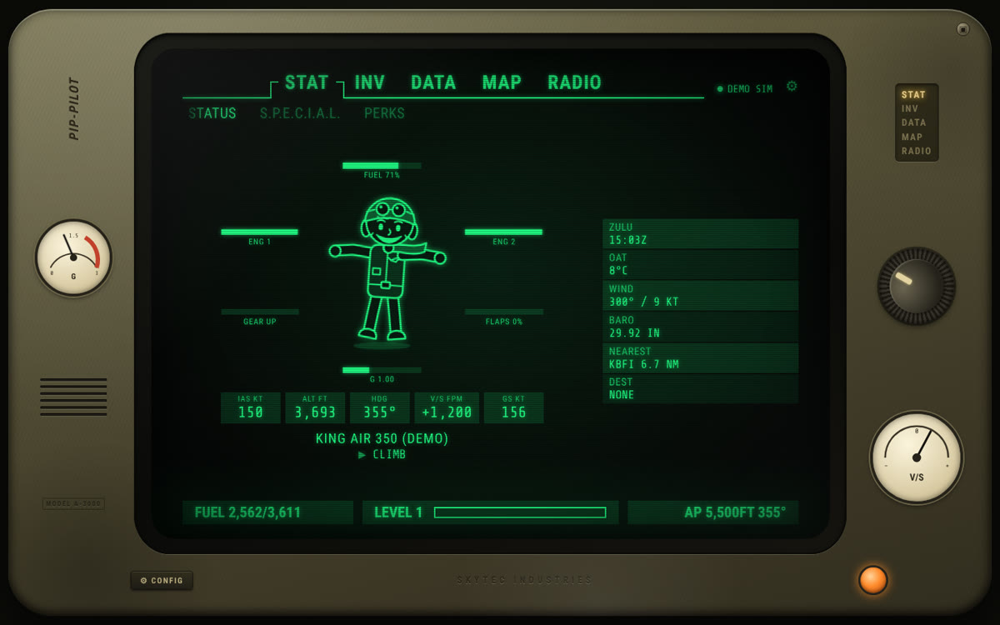
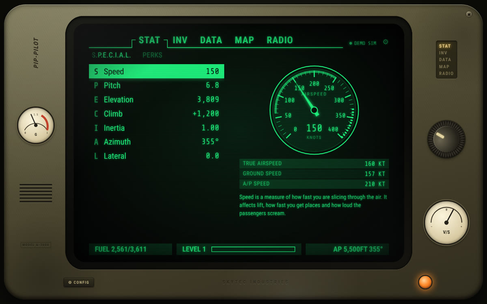
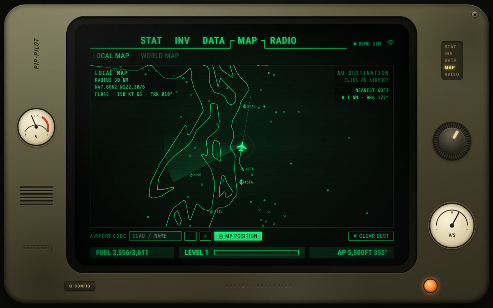
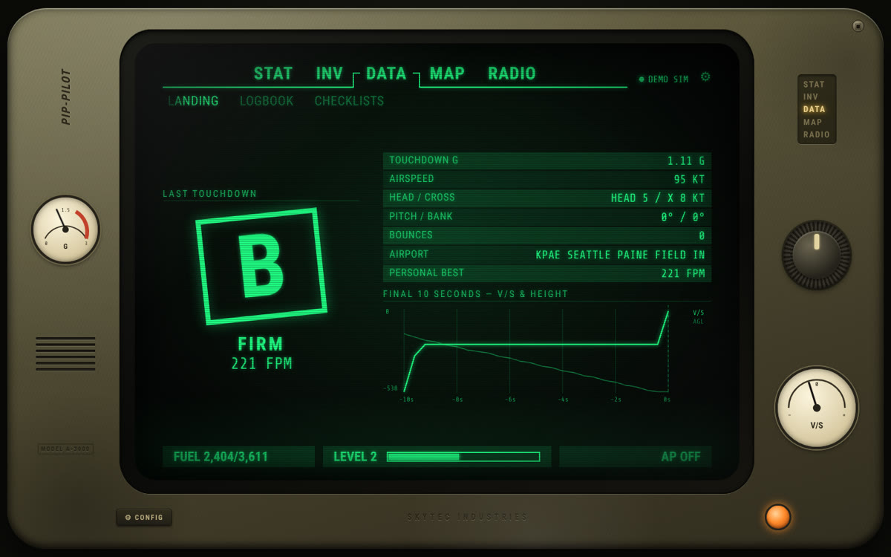
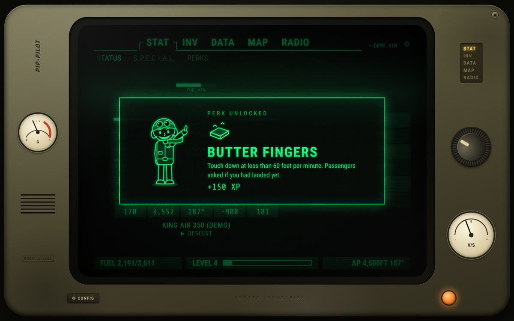
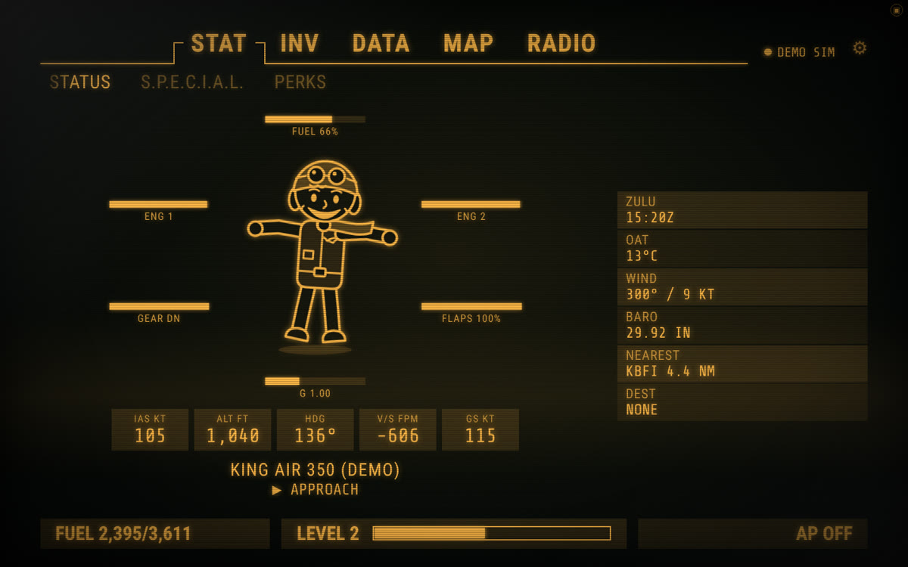

# PIP-PILOT 3000

A retro-futuristic, wrist-computer style **flight companion for X-Plane 12 and Microsoft Flight Simulator 2024**.
It's a green-phosphor CRT "wrist computer" that sits on a second monitor, a tablet or your phone. It shows your
flight live, grades your landings and keeps a logbook. You earn XP, levels and perks as you fly.



## What it does

| Tab | Pages | What you get |
| --- | --- | --- |
| **STAT** | STATUS · S.P.E.C.I.A.L. · PERKS | Animated aviator mascot with condition bars (fuel, engines, gear, flaps, G-load) that reacts to your flying. *S.P.E.C.I.A.L.* = **S**peed, **P**itch, **E**levation, **C**limb, **I**nertia, **A**zimuth, **L**ateral, each with a live animated instrument. 19 perks to unlock. |
| **INV** | SYSTEMS · FUEL · ENGINES | Aircraft "inventory": gear, flaps, brakes, autopilot, lights, transponder. Animated fuel tank with endurance, range and **fuel-at-destination** estimates. Engine cards with spinning fans. |
| **DATA** | QUESTS · LANDING · LOGBOOK · CHECKLISTS | Your current flight as a quest with objectives. A **landing report** with a grade from S to F, fpm, G, crosswind, bounces and a graph of the last 10 seconds. An automatic logbook with track maps. Interactive checklists. |
| **MAP** | LOCAL · WORLD | Vector moving map on a real globe. It zooms from a spinning planet down to runway level with 48,000 airports, runways, your trail, a radar sweep, a fuel-range ring and a great-circle line to your destination. Click an airport to set it as your destination. |
| **RADIO** | — | COM/NAV/XPDR readouts plus internet radio with a live oscilloscope. Retro lounge stations are preset and you can add your own, for example LiveATC feeds. |

Pilot career: every flight earns XP (distance, airtime, landing quality, perks). Level-ups and perk unlocks get
full-screen announcements.

Looks: boot sequence, CRT scanlines, flicker, glow and noise, glitchy tab transitions, a rotating tab knob on the
casing, live G and V/S needles, synthesized UI sounds and five colour themes (green, amber, blue, white, night red).

## Install (Windows)

1. Download the latest build from the **Actions** tab, under the *Build Windows app* artifact. It contains an installer and a portable `.exe`.
2. Run it. The app finds the simulator by itself.

### X-Plane 12
Nothing to install. PIP-PILOT talks to X-Plane's built-in UDP interface on port **49000**.
If no data arrives, open X-Plane **Settings → Network** and make sure incoming UDP (port 49000) is accepted.
If X-Plane runs on another PC, set its IP address under **⚙ CONFIG → X-PLANE ADDRESS**.

### MSFS 2024 (and 2020)
Nothing to install either. PIP-PILOT speaks SimConnect natively and connects to the running simulator.
For a remote simulator PC, put a standard `SimConnect.cfg` in your user folder.

### Use a phone or tablet as the screen
**⚙ CONFIG → COMPANION DEVICES → ALLOW PHONES / TABLETS**, then open the address shown on any device on your
network. Windows may ask you to allow the app through the firewall.

## Controls

| Key | Action |
| --- | --- |
| `1`–`5`, `Q` / `E` | Switch tab (or click / scroll the knob on the casing) |
| `A` / `D`, `◀` / `▶` | Switch sub-page |
| `W` / `S`, `▲` / `▼`, mouse wheel | Move selection |
| `Enter` | Activate (tune a station, tick a checklist item…) |
| Map | Drag to pan, wheel or `+` / `−` to zoom, `C` to recenter, `F` to search an airport |
| `P` | Toggle the wrist-unit frame or screen-only mode |
| `M` | Mute UI sounds |
| `Esc` | Settings |

## Development

```bash
npm install
npm start          # Electron app
npm run demo       # browser-only: http://127.0.0.1:8155 with a simulated flight (no sim needed)
npm test           # unit + protocol tests (includes a fake X-Plane UDP server)
npm run dist       # build the Windows installer + portable exe (run on Windows or CI)
npm run build-data # re-download and rebuild airport / map data
```

`node src/server/standalone.js --sim demo --speed 4 --lan` runs the companion server without Electron.

### Architecture

```
src/
  main/            Electron shell (frameless transparent window, embeds the server)
  server/
    sim/xplane.js  X-Plane 12 RREF/UDP adapter
    sim/msfs.js    SimConnect adapter (node-simconnect, no SDK/DLL needed)
    sim/demo.js    scripted KBFI ⇄ KPAE King Air shuttle for trying it out
    sim/manager.js auto-detects which simulator is live
    flight/        phase detection, landing analysis, logbook, XP and perks
    server.js      HTTP + WebSocket (15 Hz telemetry), radio stream proxy
  web/             the UI: vanilla ES modules, canvas map, SVG gauges and mascot, WebAudio sounds
```

Both simulators are mapped onto one telemetry model, so every UI feature works with either sim.
Pilot data (profile, logbook, settings) is stored in `%APPDATA%/PIP-PILOT 3000/data`.

See [THIRD_PARTY.md](THIRD_PARTY.md) for data and font credits. PIP-PILOT 3000 is a fan-made homage and is not
affiliated with Bethesda, Laminar Research or Microsoft. The mascot and artwork are original.

## Screenshots

| | |
| --- | --- |
|  |  |
|  |  |
|  | |
